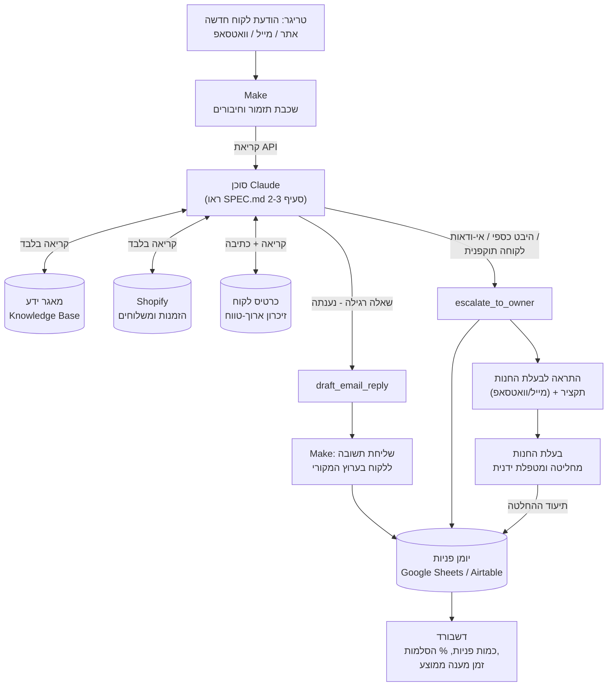

# Architecture — ארכיטקטורת המערכת סביב הסוכן

מסמך זה משלים את `SPEC.md`. שם תואר **איך הסוכן חושב** מבפנים (זיהוי כוונה, כלים, זיכרון). כאן מתוארת **התשתית שסביבו** — מאיפה פנייה נכנסת מלכתחילה, ולאן כל פיסת מידע נשלחת עד הסוף, כולל רישום ודשבורד.

## 1. טריגר — מה מפעיל את הסוכן

הסוכן אינו "מחכה" באופן פעיל — הוא מופעל רק כשקורה אחד מהאירועים הבאים:

- **הודעת לקוח חדשה** מגיעה לאחד הערוצים: צ'אט באתר, תיבת מייל של התמיכה, או וואטסאפ עסקי.
- אירוע כזה מתקבל על ידי שכבת תזמור (`Make`, לפי הבחירה שתוארה ב-SPEC.md סעיף 2) שמאזינה לערוצים הללו ברקע.
- `Make` הוא זה "שמעיר" את הסוכן: הוא אורז את תוכן ההודעה + זהות הלקוח, ושולח אותם כקריאת API לסוכן `Claude`.

כלומר: `Make` אחראי על ה**טריגר** וה**חיבורים הטכניים** (מתי להתעורר, איפה לשלוח תוצאה), ו-`Claude` אחראי על ה**חשיבה** (מה לעשות עם הפנייה) — בדיוק כמו שתואר ב-SPEC.md.

## 2. תרשים המערכת המלאה

## 3. הסבר לכל רכיב

| רכיב | תפקיד בזרימה |
|---|---|
| **טריגר** | הודעת לקוח נכנסת — זה מה שמעיר את כל המערכת. בלי הודעה חדשה, שום דבר לא רץ. |
| **Make** | "שוער" המערכת: מאזין לערוצים, מעביר פניות ל-`Claude`, ובהמשך גם מבצע את הפעולה הסופית (שליחת מייל, כתיבה ליומן) לפי מה שהסוכן החליט. |
| **סוכן Claude** | המוח המחליט: מסווג את הפנייה, קורא לכלי המתאים, מנסח תשובה או מחליט להסלים. פירוט מלא ב-SPEC.md. |
| **מאגר ידע / Shopify / כרטיס לקוח** | שלושת מקורות המידע שהסוכן קורא מהם (ולכרטיס הלקוח גם כותב) — תואר בהרחבה בסעיף 4 ל-SPEC.md. |
| **יומן פניות** (Google Sheets / Airtable) | כל פנייה — גם כזו שנענתה ישירות וגם כזו שהוסלמה — נרשמת כאן כשורה אחת: תאריך, סוג הפנייה, האם הוסלמה, זמן מענה. זהו "מסד הנתונים" שממנו הדשבורד שואב. |
| **דשבורד** | תצוגה שמסכמת את יומן הפניות: כמה פניות טופלו אוטומטית, כמה הועברו לבעלת החנות, וכמה זמן לוקח להגיב בממוצע. זו למעשה הגרסה המורחבת של "הדוח השבועי" שהוזכר כהרחבה עתידית ב-SPEC.md סעיף 8. |

## 4. סיכום הפלט — מה קורה בסוף כל פנייה

לכל פנייה יש בדיוק אחת משתי תוצאות אפשריות:

1. **מענה ישיר ללקוח** — כשאין בפנייה שום היבט כספי, והמידע הדרוש נשלף בהצלחה. התשובה נשלחת, ובמקביל נרשמת שורה ביומן הפניות.
2. **הסלמה לבעלת החנות** — בכל מקרה כספי, רגיש, או לא-ודאי. בעלת החנות מקבלת התראה עם תקציר, מחליטה בעצמה, וההחלטה שלה (ולא רק עצם ההסלמה) נרשמת גם היא ביומן — כדי שהדשבורד ישקף תמונה מלאה, כולל מה קרה בפועל עם כל הסלמה.
