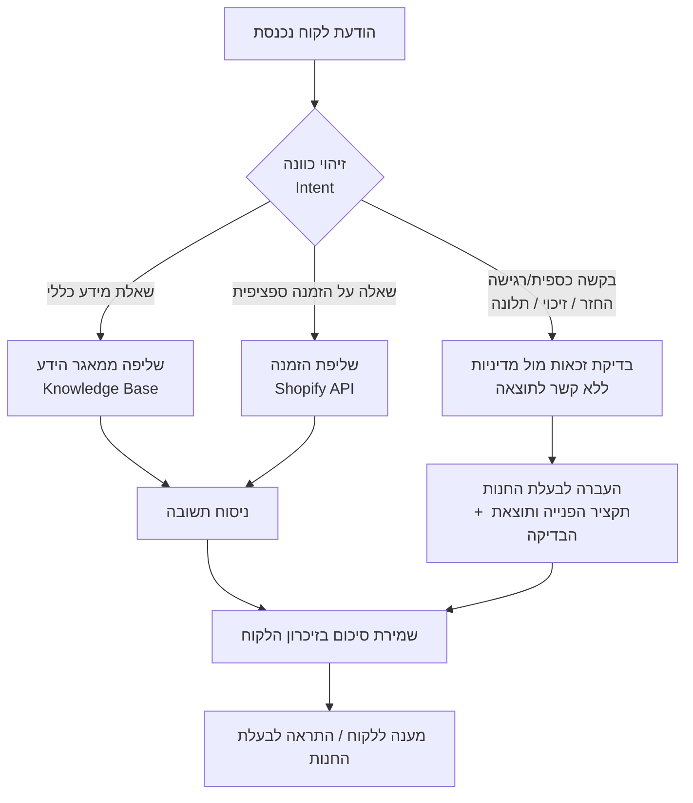

# SPEC — סוכן AI לשירות לקוחות בחנות Shopify

מסמך תכנון (Spec) שנכתב ומאושר **לפני** תחילת הבנייה — קודם מפרט, אחר כך קוד.

## 1. רקע ובחירת הסוכן

נבחר לתכנון סוכן שירות לקוחות אוטומטי לחנות `Shopify` אמיתית שבבעלותי. שם החנות והמוצר הנמכר בה הושמטו בכוונה מהמסמך כדי לשמור על אנונימיות — הם אינם משפיעים על התכנון עצמו, ובמקומם מופיע לאורך המסמך "החנות" ו"המוצר".

### הגדרת תפקיד (Role Definition)

מעבר לתיאור הכללי "סוכן שירות לקוחות", לסוכן יש הגדרת זהות מפורשת וקבועה, שתשמש בסיס להנחיה שתינתן לו בפועל:

> את/ה נציג/ת שירות לקוחות של חנות אונליין. תפקידך לענות בעברית, בנימוס ובמקצועיות, על פניות לקוחות לגבי הזמנות, מוצרים, משלוחים והחזרות — אך ורק על סמך מידע שנשלף בפועל מהכלים העומדים לרשותך. בכל מקרה של ספק, חריגה ממדיניות, או פנייה רגישה — את/ה מעביר/ה את הטיפול לבעלת החנות ולא מחליט/ה לבד.

הסיבות לבחירה:

- מדובר בצורך אמיתי וקיים — חנות פעילה, לא תרחיש היפותטי.
- הסוכן משלב בצורה טבעית את שלושת הנושאים שהתבקשנו להתייחס אליהם: אופן הפעולה, כלים, וניהול זיכרון.
- זהו צעד ראשון טבעי לקראת המטרה של הטמעת AI בעסקים.

### מה הסוכן אמור לפתור

לקוחות שכותבים לחנות (בצ'אט באתר, באימייל או בוואטסאפ) עם שאלות חוזרות: איפה ההזמנה שלי, איך משתמשים נכון במוצר, מה מדיניות ההחזרות, האם יש קוד הנחה. כיום כל פנייה כזו מגיעה אל בעלת החנות באופן ידני. הסוכן אמור לענות על הפניות הפשוטות באופן עצמאי, ולהעביר לבעלת החנות רק את מה שבאמת דורש החלטה אנושית.

### מה הסוכן *לא* עושה (גבולות גזרה)

- **אינו נוגע בכסף בשום צורה ובשום סכום** — לא מבצע החזר, לא מזכה, לא מאשר ולא קובע סכום. כל בקשה שיש בה היבט כספי (החזר, זיכוי, הנחה חריגה) מועברת ישירות לבעלת החנות להחלטה, קטנה כגדולה. תפקיד הסוכן מוגבל לבדוק זכאות מול מדיניות קבועה (למשל: האם עברו 14 יום) ולהכין תקציר לבעלת החנות — לא להחליט או לבצע.
- לא משנה הזמנה בשום אופן.
- לא ממציא מידע שאינו קיים במקורות הידע שלו.
- לא מנהל משא ומתן על מחיר ולא מנפיק קודי הנחה בעצמו בשום מקרה — כל בקשה להנחה מועברת לבעלת החנות.
- אין לו גישה לפרטי תשלום של הלקוח (מספרי כרטיס אשראי, חשבון בנק וכדומה) בשום שלב — נתונים אלו מנוהלים רק על ידי `Shopify` עצמו.
- אינו ניגש לשום מערכת או נתון מעבר למה שמוגדר במפורש בטבלת הכלים שבסעיף 3.

### כלל קבוע: טון ותקשורת

הסוכן **לעולם לא מקלל, לא עונה בגסות ולא מתווכח** עם לקוחה — גם אם היא כותבת בכעס, בגסות או בטון פוגעני. הכלל הזה קבוע מראש בהנחיות הסוכן ואינו ניתן לשינוי על ידי שום הודעת לקוח ("System Prompt" קבוע, לא תלוי-הקשר). כאשר לקוחה כותבת בצורה תוקפנית:

- הסוכן ממשיך לענות בנימוס ובמקצועיות, מתמקד בפתרון הבעיה עצמה.
- אם התוקפנות נמשכת או מחריפה, זהו טריגר נוסף להפעלת `escalate_to_owner` (ראו סעיף 3) — לא כדי "להיפטר" מהלקוחה, אלא כדי שבעלת החנות תטפל אישית במקרה רגיש.

## 2. ארכיטקטורה כללית — איך הסוכן פועל

### פלטפורמת המימוש

הסוכן מבוסס על מודל שפה של `Claude` (Anthropic), שמשמש כ"מוח" המקבל את ההחלטות — מזהה כוונה, בוחר אילו כלים להפעיל, ומנסח את התשובה. זו הבחירה המתאימה כאן (ולא למשל פלטפורמת אוטומציה כמו `Make`), כי התפקיד דורש הבנה של שפה חופשית וטון, והחלטה דינמית בכל פנייה מחדש — ולא תהליך קבוע וליניארי. בהמשך אפשר לשלב גם `Make` לביצוע פעולות רקע ספציפיות (לדוגמה שליחת מייל), כשקלוד הוא זה שמחליט *מתי* להפעיל אותן.

הסוכן בנוי כלולאת "תפיסה → חשיבה → פעולה" (Perception → Reasoning → Action), שחוזרת על עצמה עד שהפנייה נסגרת:

שלבי התהליך בפירוט:

1. **קליטת פנייה** — הודעת טקסט מגיעה מערוץ כלשהו (אתר/אימייל/וואטסאפ).
2. **זיהוי כוונה (Intent Detection)** — הסוכן מסווג את הפנייה: שאלה כללית, שאלה על הזמנה קיימת, בקשת החזר/תלונה, או משהו שאינו מזוהה.
3. **שליפת מידע (Retrieval)** — בהתאם לסיווג, הסוכן פונה לכלי המתאים (מאגר ידע, Shopify, או שניהם).
4. **הפעלת מדיניות (Policy Check)** — לכל בקשה עם היבט כספי (החזר, זיכוי, תלונה) יש בדיקת זכאות מול כללים קבועים מראש (למשל: עברו 14 יום?). **ללא קשר לתוצאת הבדיקה**, הפנייה תמיד עוברת לבעלת החנות להחלטה — הבדיקה רק מצרפת מידע לתקציר, ואינה מספיקה בעצמה כדי שהסוכן "יאשר" משהו.
5. **ניסוח תשובה** — תשובה בעברית, בטון אדיב ועקבי למותג, המבוססת רק על מה שנשלף בפועל (לא "להמציא").
6. **עדכון זיכרון** — שמירת תקציר קצר של האינטראקציה בכרטיס הלקוח, לשימוש בפניות הבאות.
7. **סגירה/העברה** — שליחת המענה ללקוח, או התראה לבעלת החנות אם נדרש אישור.

## 3. כלים (Tools)

| כלי | תפקיד | מתי נקרא | סיכון עיקרי וכיצד ממותן |
|---|---|---|---|
| `shopify_get_order` | שליפת סטטוס הזמנה, פרטי משלוח ותשלום לפי מספר הזמנה/אימייל | כאשר הלקוח שואל על הזמנה קיימת | קריאה בלבד (read-only); אין הרשאת כתיבה להזמנות |
| `knowledge_base_search` | חיפוש במאגר שאלות נפוצות, מפרט המוצר, מדיניות משלוחים והחזרות | לכל שאלת מידע כללית | אם אין תוצאה רלוונטית — הסוכן אומר שאינו יודע, ולא מנחש |
| `refund_policy_check` | בדיקת זכאות של בקשת החזר/ביטול מול כללים קבועים (למשל: עד 14 יום, המוצר לא נפתח) | לכל בקשת החזר, זיכוי או ביטול | הכלי **רק מצרף מידע לתקציר שמועבר לבעלת החנות** — אינו מאשר, אינו מבצע ואינו "סוגר" את הבקשה בעצמו בשום מקרה |
| `escalate_to_owner` | שליחת התראה לבעלת החנות עם תקציר הפנייה, כולל קישור לשיחה המלאה | **כל בקשה עם היבט כספי כלשהו (החזר/זיכוי/הנחה), בכל סכום וללא יוצא מן הכלל**, וכן תלונה, חוסר ודאות של הסוכן, או לקוחה תוקפנית/גסה שממשיכה למרות מענה מנומס | אין — זהו מנגנון הבטיחות המרכזי של הסוכן |
| `draft_email_reply` | ניסוח טיוטת מייל/הודעה ללקוח | בסיום כל תהליך מענה | טיוטה בלבד בפניות גבוליות; שליחה אוטומטית רק בפניות "ירוקות" מוגדרות מראש |
| `customer_memory_read / write` | קריאה/כתיבה לכרטיס לקוח בזיכרון (ראו סעיף 4) | בתחילת כל שיחה (קריאה) ובסופה (כתיבה) | רק תמציות עובדתיות נשמרות — לא תוכן רגיש מעבר לנדרש לשירות |

כל הכלים הם **קריאה-בלבד** (read-only) כלפי מערכות הליבה (Shopify), חוץ מ-`escalate_to_owner` ו-`draft_email_reply`, שהן פעולות "דיווח/ניסוח" ולא פעולות בלתי הפיכות. שום כלי אינו מבצע חיוב, זיכוי, או שינוי מלאי בעצמו.

### אבטחת מידע: מפתחות API

כדי שהכלים האלו יעבדו בפועל (למשל `shopify_get_order`), הסוכן יזדקק למפתח API אמיתי מול Shopify. מפתח כזה **לעולם לא נכתב בתוך הקוד ולא עולה לריפו בגלוי**.

חשוב להבהיר למה דווקא כך: חיבור "ישיר" לחנות דרך קלוד (Connector) מתאים למצב שבו מישהי יושבת מול קלוד ומבקשת ממנו לבדוק משהו באופן מיידי. הסוכן הזה שונה — הוא צריך לפעול **באופן אוטונומי וברקע**, לענות ללקוחות במספר ערוצים (אתר/מייל/וואטסאפ) בלי שבעלת החנות נוכחת בכל שיחה. תהליך רקע כזה חייב גישה עצמאית למפתח, ולכן הוא יישמר כ-`Secret` בסביבה שבה הסוכן בפועל רץ:

- אם הסוכן ייבנה כאוטומציה/קוד שרץ דרך `GitHub Actions` — כ-`GitHub Secret` (כפי שכבר נעשה בפרויקט `stocks-dashboard`).
- אם ייבנה דרך `Make` — בתוך החיבור המאובטח הפנימי של Make עצמו, לא כקובץ גלוי.

בשני המקרים — לא מדובר באחסון כלשהו אצל Anthropic, אלא בסביבת ההרצה הספציפית של הסוכן.

## 4. ניהול זיכרון (Memory)

לסוכן שלוש שכבות זיכרון נפרדות, כל אחת עם מטרה וחיי מדף משלה:

### 4.1 זיכרון שיחה (Working Memory)
- קיים רק למשך השיחה הנוכחית.
- מכיל את ההודעות האחרונות ואת תוצאות הכלים שנקראו בה (למשל: פרטי ההזמנה שנשלפה).
- נמחק בסיום השיחה — אינו נשמר באופן קבוע.

### 4.2 כרטיס לקוח (Long-Term Customer Memory)
- רשומה קצרה וקבועה לכל לקוח (לפי אימייל/מזהה), לדוגמה: מספר פניות קודמות, האם יש בעיה פתוחה, האם קיבל פעם קוד הנחה כפיצוי.
- **לא** נשמרת בו היסטוריית שיחה מלאה — רק תמצית עובדתית, כדי לצמצם חשיפת מידע מיותר.
- משמש לזיהוי "לקוח חוזר עם תלונה" מול "פנייה ראשונה", וכך לדעת מתי להסלים ביתר זהירות.

### 4.3 מאגר ידע (Knowledge Base — זיכרון חיצוני משותף)
- לא "זיכרון" במובן השיחתי אלא מסד ידע קבוע שהסוכן קורא ממנו: מפרט מוצר, שאלות נפוצות, מדיניות משלוחים והחזרות.
- מתעדכן ידנית על ידי בעלת החנות — הסוכן לעולם לא כותב למאגר הזה בעצמו, רק קורא ממנו.
- הפרדה זו מבטיחה שמדיניות החנות תמיד מדויקת ואינה "נשחקת" על ידי הסוכן עצמו.

### עקרונות מנחים לזיכרון
1. **הפרדת קריאה/כתיבה** — הסוכן קורא ממאגר הידע אך אינו כותב אליו; הוא קורא *וגם* כותב לכרטיס הלקוח, בשכבה נפרדת.
2. **מינימום נתונים** — נשמר רק מה שבאמת משפיע על פנייה עתידית, לא תיעוד מלא של כל שיחה.
3. **שקיפות ללקוח** — אם לקוח מבקש זאת, ניתן להציג מה שמור עליו בכרטיס הלקוח ולמחוק לפי בקשה.
4. **אין החלטות קבועות על בסיס שיחה אחת** — הסלמה לבעלת החנות מתבצעת כל עוד הסוכן אינו בטוח ב-100%, גם אם כבר יש מידע קודם בכרטיס הלקוח.

## 5. מגבלות תפעוליות (Guardrails)

אלו החלטות עסקיות, ולכן הן נקבעות כבר כאן במפרט ולא רק בשלב הבנייה בפועל:

- **מספר פעולות מקסימלי לשיחה** — הסוכן רשאי לבצע עד 5 קריאות לכלים (Tool Calls) באותה שיחה. אם הפנייה עדיין לא נפתרה אחרי כך — הסוכן מפסיק לנסות "לבד" ומפעיל `escalate_to_owner` אוטומטית, במקום להיכנס ללולאה.
- **אין סף כספי אוטומטי** — אין שום סכום שבו הסוכן "מאשר" או "מטפל" בעצמו. כל בקשה עם היבט כספי, בכל סכום, מגיעה לבעלת החנות להחלטה — ראו סעיף 1.
- **ללא פעולה כפולה** — אם כלי מסוים (כמו `shopify_get_order`) כבר נקרא באותה שיחה, הסוכן אינו קורא לו שוב עם אותם פרמטרים — נמנע מבזבוז קריאות ומתשובות סותרות.

## 6. דוגמת אינטראקציה

**לקוחה:** "שלום, הזמנתי אצלכם לפני שבוע ועדיין לא קיבלתי, מה קורה?"

1. זיהוי כוונה → "שאלה על הזמנה קיימת".
2. קריאה ל-`shopify_get_order` עם האימייל של הלקוחה.
3. נמצא: ההזמנה נשלחה לפני 3 ימים, עדיין בדרך לפי חברת השילוח.
4. ניסוח תשובה: עדכון סטטוס + זמן משלוח צפוי, ללא צורך בהסלמה.
5. כתיבה לכרטיס הלקוחה: "פנייה בנושא עיכוב במשלוח — נענתה ישירות, ללא תלונה".

**לעומת זאת**, אם הלקוחה הייתה כותבת "המוצר הגיע שבור, אני רוצה החזר כספי מלא" — הסוכן היה מפעיל את `refund_policy_check`, מזהה שמדובר במוצר פגום (מקרה שחורג ממדיניות ההחזר הסטנדרטית), ומפעיל מיידית את `escalate_to_owner` עם תקציר הפנייה, במקום להחליט בעצמו.

## 7. מדדי הצלחה אפשריים

- אחוז הפניות שנסגרו על ידי הסוכן ללא צורך בהתערבות ידנית.
- זמן ממוצע עד מענה ראשון ללקוח.
- אחוז ההסלמות שהיו מוצדקות בפועל (כדי לוודא שהסוכן לא "מסלים יותר מדי" מצד אחד, ולא "מחליט לבד" במקרים רגישים מצד שני).

בשלב זה לא נקבעים יעדים מספריים (לדוגמה "80% מהפניות ייסגרו אוטומטית"), מכיוון שאין עדיין נתוני בסיס אמיתיים מהפעלת הסוכן. היעדים ייקבעו רק אחרי תקופת הפעלה ראשונית (Baseline), על בסיס נתונים אמיתיים ולא ניחוש.

## 8. הרחבות עתידיות אפשריות

- חיבור ערוץ וואטסאפ עסקי בנוסף לצ'אט האתר.
- הצעת מוצרים משלימים (Upsell) בהתבסס על היסטוריית רכישות — רק כהמלצה, לא כפעולה אוטומטית.
- דוח שבועי אוטומטי לבעלת החנות עם סיכום הפניות והנושאים החוזרים — נשלח כמייל (הערוץ הכי נגיש), עם אפשרות לשמור את אותם נתונים גם בטבלה (`Google Sheets` או `Airtable`) לצורך מעקב היסטורי לאורך זמן.
